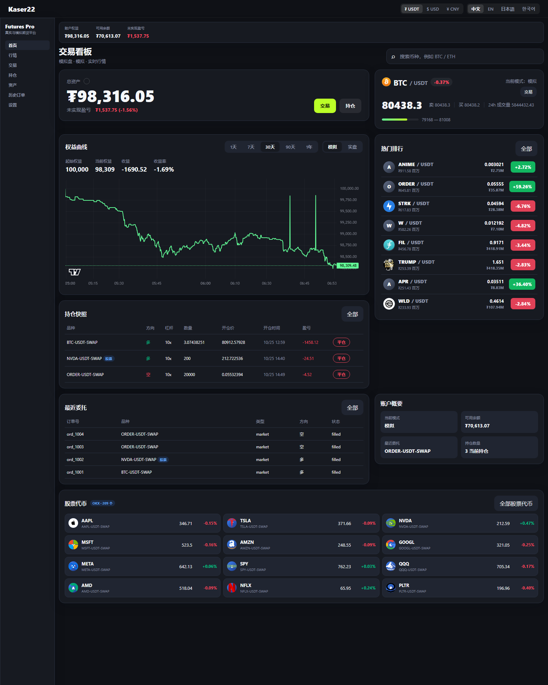
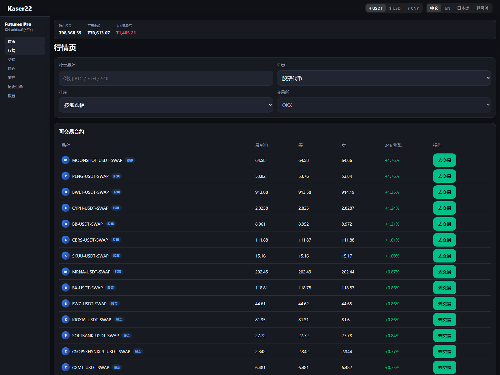
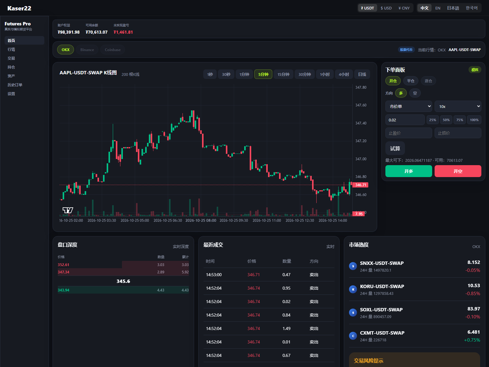

# OKX Trading · 多交易所行情与模拟合约交易工作台

一个面向学习与演示的期货交易工作台：接入 **OKX / Binance / Coinbase** 实际行情，支持 K 线、盘口、成交、模拟开平仓、限价撮合、止盈止损、强平、资金流水和权益曲线，并把 **股票代币** 与加密货币分开展示。

> ⚠️ 本项目当前定位为模拟交易/行情演示，**不构成投资建议**。真实盘下单尚未接入，请勿用于真实资金交易。



## 功能概览

### 行情

- OKX：USDT 本位永续，当前 507 个合约
- Binance：USDT 本位永续，当前 522 个合约
- Coinbase：USD 现货，当前 8 个主流交易对
- K 线：`1m / 5m / 15m / 30m / 1h / 4h / 1d`
- K 线支持鼠标拖拽平移、滚轮缩放；实时刷新不会抢回用户拖拽后的位置
- 盘口深度、最近成交、24H 涨跌/成交量
- OKX/Binance 实时 WebSocket；Coinbase 使用 REST 轮询
- 交易页顶部可切换 OKX / Binance / Coinbase，路由和 K 线同步切换

### 股票代币（独立分类）

- 来源：OKX 公共 API，`instCategory = 3` 的 USDT 永续合约
- 当前 **209 个**股票代币/ETF/Pre-IPO 标的
- 首页有独立“股票代币”板块；行情页有“股票代币”分类
- 股票代币交易页显示“股票代币”徽标，并禁用 Binance/Coinbase（这两家当前没有这些标的）
- 常见股票使用品牌图标；没有稳定图标的标的用蓝色渐变字母块，不会出现白圈

### 预测市场（独立模块）

- 数据源：Polymarket（Gamma 市场元数据 / CLOB 盘口与价格历史 / Data API 成交）
- 独立后端模块 `prediction`，接口前缀 `/api/v1/prediction`，与合约行情完全解耦
- 独立前端页面 `/prediction`，侧边栏“预测市场”入口
- 支持关键词搜索，按 24H 成交量 / 流动性 / 即将结算 / 最新上线排序
- 市场详情：YES/NO 概率、概率走势、订单簿、最近成交、市场说明与相关市场
- 模拟交易：买入/卖出 YES/NO 份额，全额使用同一份模拟资金，不占保证金、不加杠杆
- 预测持仓按当前概率估值，支持浮动盈亏、部分卖出和平仓，并计入账户权益和资金流水
- 当前不接入 Polymarket 真实下单（需要钱包与 CLOB 签名）

### 模拟交易

- 初始资金 8,000 USDT
- 逐仓、单向持仓
- 杠杆 1–50x
- 市价单、限价单
- 开多/开空、部分平仓、全部平仓、撤单
- 止盈止损、后台自动撮合、强制平仓
- 手续费、保证金冻结/释放、已实现/未实现盈亏
- 资金流水、权益曲线、模拟账户重置
- 现货交易：OKX / Coinbase 现货行情，市价买入/卖出，持仓按最新价计入账户权益
- 数据持久化到 `backend/data/simulation.json`

### 界面与工程

- Vue 3 + Vite + Pinia，桌面优先、移动端自适应
- 中文 / English / 日本語 / 한국어
- 深色 / 浅色主题、计价货币切换
- Windows 一键启动/停止脚本
- Electron 桌面壳、Capacitor Android 构建脚手架

## 截图

### 股票代币独立板块


### 全部股票代币



### 股票代币交易页



## 技术栈

| 层 | 技术 |
|---|---|
| 前端 | Vue 3、Vite、Pinia、Vue Router、lightweight-charts、Socket.IO |
| 后端 | NestJS 11、TypeScript、Axios、ws、Socket.IO |
| 数据 | 开发期 JSON 持久化；`prisma/schema.prisma` 预留给后续 SQLite/Prisma 迁移 |
| 桌面 | Electron、electron-builder、electron-updater |
| 移动端 | Capacitor Android |
| 测试 | `ts-node` 纯引擎自测（26 项，含预测盘交易） |

## 目录结构

```text
.
├── backend/                 # NestJS 后端
│   ├── src/modules/
│   │   ├── market/          # OKX / Binance / Coinbase 行情、K线、盘口、成交
│   │   ├── prediction/      # 预测市场（Polymarket 行情、概率、盘口、成交）
│   │   ├── simulation/      # 模拟盘账务引擎、撮合、持久化
│   │   ├── orders/          # 下单、试算、撤单
│   │   ├── positions/       # 持仓、平仓、止盈止损
│   │   ├── account/         # 资产、流水、权益曲线、OKX API 账户
│   │   └── ws/              # 交易所 WebSocket 转发
│   └── scripts/
│       └── simulation-selftest.ts
├── frontend/                # Vue 3 前端
│   ├── src/pages/           # 首页、行情、交易、持仓、资产、订单、设置
│   ├── src/components/      # 图表、下单面板、币种图标等
│   └── src/stores/          # 行情、订单、持仓、资产、模式
├── desktop/                 # Electron 桌面打包
├── docs/screenshots/        # README 截图
├── scripts/                 # 一键启动/停止 PowerShell 脚本
├── start-dev.bat            # Windows 一键启动
├── stop-dev.bat             # Windows 一键停止
├── *_设计.md                # 产品、接口、数据库、模块设计文档
└── README.md
```

## 快速启动（Windows）

### 一键启动

双击根目录的：

```text
start-dev.bat
```

脚本会：

1. 使用 DSH 自带 Node（不依赖系统 Node/npm）
2. 检查 `3000`、`5173` 端口
3. 检查本地 `node_modules`（不会联网下载依赖或其他工具）
4. 构建后端并在新窗口启动后端和前端
5. 等待端口就绪后打开浏览器

启动后：

- 前端：<http://127.0.0.1:5173/>
- 后端：<http://127.0.0.1:3000/api/v1/health>

### 一键停止

```text
stop-dev.bat
```

会按启动时保存的 PID 结束前后端进程树，并清理 `.dev-pids.json`；如果 PID 文件丢失，会按端口兜底清理。

### 依赖说明

启动脚本不会联网安装 Node、npm 依赖或其他工具，也不会自动执行 `npm install`。

仓库需要保留以下目录：

```text
backend/node_modules
frontend/node_modules
```

如果缺少依赖，`start-dev.bat` 会直接提示并退出，而不会下载任何内容。

### 手动启动（需要系统 Node/npm）

```bash
# 后端
cd backend
npm run start:dev

# 前端（新终端）
cd frontend
npm run dev
```

## 数据与接口

### 行情数据源

| 交易所 | API | 交易对格式 |
|---|---|---|
| OKX | `https://www.okx.com/api/v5` | `BTC-USDT-SWAP` |
| Binance | `https://fapi.binance.com/fapi/v1` | `BTCUSDT` |
| Coinbase | `https://api.exchange.coinbase.com` | `BTC-USD` |

### 股票代币识别

OKX `/public/instruments?instType=SWAP` 返回的 `instCategory`：

- `1`：加密货币
- `3`：股票代币

后端会将结果统一成：

```json
{
  "symbol": "AAPL-USDT-SWAP",
  "baseCoin": "AAPL",
  "assetClass": "stock"
}
```

### 常用接口

```text
GET /api/v1/market/symbols?exchange=okx
GET /api/v1/market/tickers?exchange=okx
GET /api/v1/market/klines?symbol=AAPL-USDT-SWAP&interval=5m&exchange=okx
GET /api/v1/market/klines?symbol=BTCUSDT&interval=5m&exchange=binance
GET /api/v1/market/klines?symbol=BTC-USD&interval=5m&exchange=coinbase
GET /api/v1/market/depth?symbol=AAPL-USDT-SWAP&exchange=okx
GET /api/v1/market/trades?symbol=AAPL-USDT-SWAP&exchange=okx
```

现货行情与模拟交易接口：

```text
GET /api/v1/spot/markets?exchange=okx
GET /api/v1/spot/tickers?exchange=okx
GET /api/v1/spot/klines?symbol=BTC-USDT&interval=5m&exchange=okx
GET /api/v1/spot/holdings
GET /api/v1/spot/orders?symbol=BTC-USDT
POST /api/v1/spot/orders
```

预测市场接口（独立模块）：

```text
GET /api/v1/prediction/markets?limit=24&sort=volume&keyword=bitcoin
GET /api/v1/prediction/markets/:slug
GET /api/v1/prediction/markets/:slug/history?interval=1w
GET /api/v1/prediction/markets/:slug/orderbook?depth=20
GET /api/v1/prediction/markets/:slug/trades?limit=50
GET /api/v1/prediction/positions
GET /api/v1/prediction/orders?slug=:slug
POST /api/v1/prediction/orders
POST /api/v1/prediction/positions/:id/close
```

接口设计详见 [前后端接口设计.md](前后端接口设计.md)。

## 交易模式状态机

交易模式由服务端持久化到 `backend/data/account-mode.json`，前端刷新、换标签页或重启服务后都以服务端为准。

```text
simulation → live_readonly → live_trading
     ↑             ↓               ↓
     └─────────────┴───────────────┘
```

- `simulation`：模拟盘
- `live_readonly`：实盘只读，必须先绑定并激活 OKX API 账户
- `live_trading`：实盘交易，必须从 `live_readonly` 进入，并校验 API 交易权限与 USDT 可用保证金

接口：

```text
GET /api/v1/account/mode
PUT /api/v1/account/mode { "mode": "simulation" | "live" | "live_readonly" | "live_trading" }
```

`GET` 返回兼容字段 `mode`（`simulation` / `live`）、真实状态 `state`、能力位 `capabilities`、阻塞原因 `blockers` 和最近一次迁移记录。非法迁移会返回业务错误码 `4100` / `4101` / `4102`。

### 能力矩阵

所有业务接口以服务端模式为准，忽略前端传入的 `mode`，不再用空数组表示“不支持”。

| 能力 | simulation | live_readonly / live_trading |
|---|---|---|
| 行情 / K 线 / 深度 | 允许 | 允许 |
| 合约持仓 / 当前委托 | 模拟 | 读取 OKX |
| 合约下单 / 平仓 / 撤单 | 允许 | 暂未开放（返回 `4201`） |
| 现货持仓 / 成交 | 模拟 | 默认隐藏（返回 `4201`） |
| 预测持仓 / 成交 | 模拟 | 默认隐藏（返回 `4201`） |
| 现货买卖 / 预测买卖 | 允许 | 禁止（返回 `4201`） |
| 资金流水 / 收益曲线 | 模拟 | 禁止（返回 `4201`） |

### 交易所 API 密钥安全

- `apiKey` / `apiSecret` / `passphrase` 使用 AES-256-GCM 加密后写入 `backend/data/accounts.json`
- 主密钥来自 `ACCOUNT_ENCRYPTION_KEY`（64 位 hex 或 32 字节 base64）
- 生产环境未设置该环境变量会拒绝启动；开发环境回退到 `backend/data/account-encryption.key`
- 文件里只有密文、`apiKeyMasked`（后 4 位）和不可逆 SHA-256 指纹
- 旧版明文 `accounts.json` 启动时自动加密重写，不保留明文备份
- 绑定 API Key 时调用 OKX 账户配置接口做权限自检；检测到 `withdraw` 权限直接拒绝，不落盘
- OKX 请求日志只记录状态码/业务码/数据条数，不打印完整响应、请求头或密钥
- `GET /exchange-accounts`、绑定和测试响应只返回脱敏字段，不含任何明文密钥

### 认证与用户隔离

- 用户、密码哈希和 refresh token 存在 `backend/data/app.db`（SQLite）
- 密码使用 scrypt + 随机盐哈希
- access token 为 HS256 JWT（15 分钟），refresh token 为不透明随机串（30 天）并持久化
- refresh token 单次使用、轮换；前端 401 后用单飞刷新重试
- 全局 `AuthGuard`：无 token/错误 token 返回 401
- 行情、K 线、预测市场列表等只读行情接口匿名开放；账户、持仓、委托、流水、凭证、模式接口必须登录
- 游客账号：`POST /api/v1/auth/guest`，拥有独立的模拟账户和订单/持仓/流水
- 游客账号 7 天后自动清理（启动时 + 每小时扫描，同时删除模拟账户/模式文件）
- 模拟账户、交易模式、API 账户均按 `userId` 隔离；跨用户按资源 ID 操作返回 403
- 注销会自增 `token_version` 并撤销全部 refresh token，已签发 access token 立即失效
- 登录限流：同 IP + 邮箱 10 分钟内失败 5 次，锁定 15 分钟（返回 429）
- 邮箱验证：`POST /auth/register` 发验证 token；`POST /auth/verify-email`
- 找回密码：`POST /auth/forgot-password`、`POST /auth/reset-password`；重置后旧 token 全部失效
- 2FA：`POST /auth/2fa/setup|enable|disable`，登录返回 challenge，`POST /auth/2fa/verify` 换取 token
- WebSocket `/market` 私有频道需要在 handshake `auth.token` 携带 access token；公共行情不需要

邮件默认使用控制台日志占位，生产环境需接入 SMTP/SES。开发环境注册/找回密码响应会带 `devVerificationToken` / `devResetToken`，生产环境不返回。设置 `AUTH_REQUIRE_EMAIL_VERIFICATION=true` 可强制邮箱验证后才能登录。

内置账号：

```text
演示账号：demo@test.com / demo
超级账号：super@test.com / super
游客：登录页「游客登录」
```

超级账号在实盘模式下可在设置中开启「超级权限 · 实盘模拟数据」，以只读方式查看模拟预测和现货持仓；普通账号即使伪造请求头，服务端也会拒绝。

### 实盘下单与幂等

`live_trading` 状态下支持 OKX USDT 永续市价/限价开平仓：

- 前端为每个订单生成 `clientOrderId`，网络异常重试时复用
- 服务端将 `clientOrderId` 映射持久化到 `backend/data/live-orders.json`
- 相同 `clientOrderId` + 相同参数重复提交只返回第一次结果，不重复下单
- 相同 `clientOrderId` + 不同参数返回 `4301`
- 下单结果未知时标记 `unknown`，不会自动重复提交
- `GET /api/v1/orders/live` 查看本地实盘订单
- `GET /api/v1/orders/live/:clientOrderId` 向 OKX 同步状态并返回 `mismatch` 差异标记

实盘暂不支持同时设置止盈止损，也不支持实盘现货；`live_readonly` 下所有写操作由前后端双重拒绝。

### 下单确认与风险色阶

以下任一条件触发二次确认：

- `live_trading` 真实资金下单
- 市价单
- 名义价值 > 可用余额 × 20%
- 杠杆 ≥ 20x
- 预估强平价距当前价 < 5%
- 平仓操作

确认弹窗展示方向、品种、类型、数量、杠杆、名义价值、保证金、Maker/Taker 预估手续费、预估强平价与距离、最大可开和预估最大亏损。取消确认不会调用下单接口。

强平距离统一色阶：

```text
> 30%      安全
15% ~ 30%  关注
5% ~ 15%   警告
< 5%       危险
```

持仓列表和确认弹窗共用 [risk.ts](frontend/src/utils/risk.ts)。Maker 手续费当前按 OKX 永续 0.02% 估算，Taker 使用服务端试算结果。

## 模拟盘规则

| 项目 | 规则 |
|---|---|
| 初始资金 | 8,000 USDT |
| 保证金模式 | 逐仓、单向持仓 |
| 杠杆 | 1–50x |
| Taker 手续费 | 0.05% × 名义价值 |
| Maker 手续费 | 0.02% × 名义价值 |
| 维持保证金率 | 0.5% × 标记价值 |
| 市价成交 | 买一/卖一 + 0.02% 滑点 |
| 限价单 | 冻结保证金，后台每 3 秒撮合，可撤单 |
| 止盈止损 | 后台按标记价触发市价平仓 |
| 强平 | `margin + uPnL <= 维持保证金` 时平仓 |

- 可用余额 = 钱包余额 − 持仓保证金 − 挂单冻结
- 权益恒等式：`equity = walletBalance + contractPnl + spotValue + predictionValue`
- 总浮动盈亏：`totalUnrealizedPnl = contractPnl + spotUnrealizedPnl + predictionUnrealizedPnl`
- 已实现盈亏：`realizedPnl = contractRealizedPnl + spotRealizedPnl + predictionRealizedPnl`
- `spotCost` / `predictionCost` 是成本基数，用于资产页对账明细
- 同一币种在不同交易所是独立持仓，例如 `BTC-USDT-SWAP` 与 `BTC-USD` 不互相覆盖

## 测试与构建

```bash
# 模拟盘账务自测（30 项，含预测盘、现货交易和权益恒等式）
cd backend
npm run test:simulation

# 后端类型检查 + 构建
npx tsc --noEmit
npm run build

# 前端类型检查 + 构建
cd ../frontend
npx vue-tsc --noEmit
npm run build
```

## 当前限制

- 当前是**单演示账户**，没有 JWT 登录、用户隔离和多用户并发控制
- 运行时使用 JSON 持久化，Prisma schema 尚未接入实际业务
- 实盘 API 目前只支持查询余额/持仓/委托，**没有真实下单/撤单**
- 股票代币只有 OKX 提供；Binance/Coinbase 当前没有
- 预测市场支持模拟买卖，但不接入真实下单（需要钱包与 CLOB 签名）
- Coinbase 没有批量 ticker 接口，先接入 8 个主流 USD 对，避免全量请求被限流
- 资金费率、按品种动态杠杆、后台管理系统尚未实现

## 后续路线

1. 接入 JWT + 数据库，完成用户隔离
2. 增加真实盘下单适配器、订单回报同步和密钥加密
3. 完善限价撮合、资金费率、动态保证金和风控后台
4. 优化移动端导航和桌面打包
5. 增加单元测试、接口测试和 CI

## 文档

- [真实与模拟期货交易平台完整方案](真实与模拟期货交易平台完整方案.md)
- [前后端接口设计](前后端接口设计.md)
- [数据库表结构设计](数据库表结构设计.md)
- [前端页面字段清单](前端页面字段清单.md)
- [后端模块拆分与开发顺序](后端模块拆分与开发顺序.md)

## License

MIT
